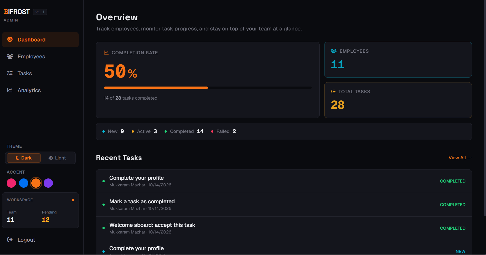

<h1 align="center">Hi, I'm Muhammad Saqib Hussnain 👋</h1>

  Full Stack Next.js Developer &nbsp;|&nbsp; Building real, deployed projects &nbsp;|&nbsp; Path: Python Backend & AI Engineering

  
  
  

---

### About Me

- BSCS student at the University of the Punjab
- Full Stack Next.js developer (App Router, TypeScript, Prisma, PostgreSQL)
- Google AI Professional Certificate holder
- Frontend Development Intern at CodeAlpha (June 2026)
- Next goal: Python backend development, then AI Engineering

---

### Featured Project

  ### Bifrost: Role-Based Task Management App &nbsp;v1.1

  

  **A full-stack task manager where admins assign and track work, and employees accept tasks and move them through New → Active → Completed / Failed.**

- Separate admin and employee dashboards. Roles are checked on every route and every server action, not just hidden in the UI
- Analytics page with area, bar and pie charts, plus search, status filters and server-side pagination
- Avatar upload, password change and optimistic delete
- Dark and light themes, and four accent colours saved to your account
- To try it, click **Try as Admin** on the login page

  

    
    
    
    
    
  

  [**Live Demo**](https://bifrost.saqibhussnain.me) &nbsp;|&nbsp; [**Source Code**](https://github.com/Saqib216/bifrost)

---

### Tech Stack

**Frontend**

  
  
  
  
  
  
  

**Backend and data**

  
  
  

**Tools and AI**

  
  
  
  
  

---

### Projects

| Project | Description | Tech | Links |
|---|---|---|---|
| Bifrost (current version: 1.1) | Full-stack, role-based task management app. Admin and employee dashboards, analytics charts, server-side pagination, dark and light themes | Next.js, TypeScript, Prisma, PostgreSQL, Auth.js, Tailwind CSS | [Live](https://bifrost.saqibhussnain.me) · [Code](https://github.com/Saqib216/bifrost) |
| Workforce Pro (earlier React version) | The frontend-only first version of the same idea. Admin and employee dashboards, full task lifecycle, dark and light mode, protected routing | React, Tailwind CSS v4, Context API, React Router | [Live](https://workforce-pro-elite.vercel.app) · [Code](https://github.com/Saqib216/employee-management-system) |
| AI Text Toolkit | Six-mode AI text processor using the Gemini API | HTML, CSS, JS, Gemini API | [Live](https://ai-text-toolkit-opal.vercel.app) |
| Spotify Clone | Music player with JSON-based playlists | HTML, CSS, JS | [Live](https://soundpulse-nine.vercel.app/) |
| Currency Converter | Real-time converter for 150+ currencies using a live API | HTML, CSS, JS | [Live](https://currency-converter-sleek.vercel.app/) |
| Calculator App | Calculator with keyboard support, expression history and advanced operations (√, x², %) | HTML, CSS, JS | [Live](https://calculator-neon-beta.vercel.app/) |
| PULSE Music Player | Glassmorphism music player with animated seek bar, volume control and a mobile slide-up overlay | HTML, CSS, JS | [Live](https://music-player-pulse.vercel.app) |
| LUMINA Image Gallery | Responsive gallery with category filters, live search and a keyboard-navigable lightbox | HTML, CSS, JS | [Live](https://image-gallery-lumina.vercel.app) |

---

### Learning Now

- Python backend development (FastAPI)
- IBM AI Engineering Specialization (Coursera)

### Certifications

- Google AI Professional Certificate
- IBM Data Science Professional Certificate
- Andrew Ng's Machine Learning Specialization
---

### GitHub Stats

  

---

  Best way to reach me: <a href="https://linkedin.com/in/saqib-hussnain">LinkedIn</a> or <a href="mailto:mdsaqibhussnain@gmail.com">email</a>.

